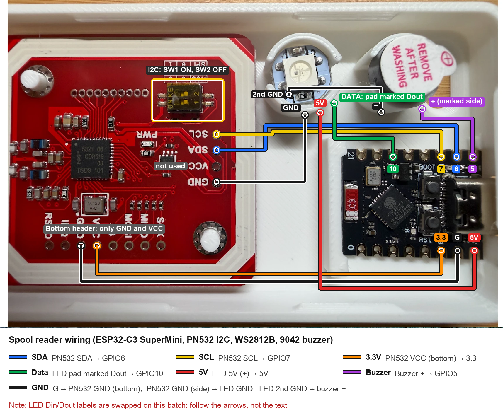
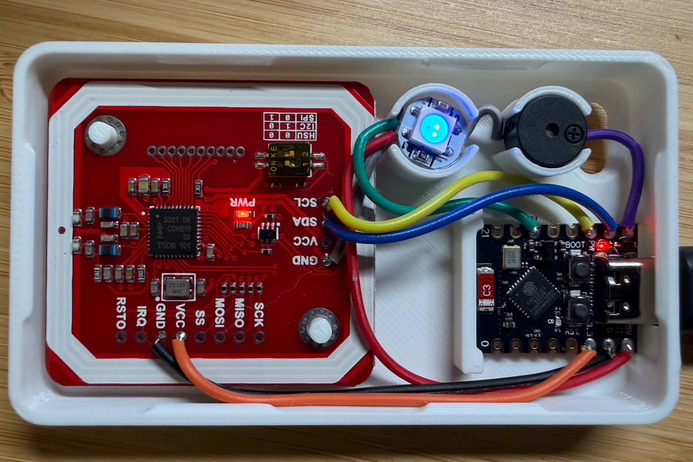

# NFC Location Tracking for Spoolman

Tap a filament spool on a small NFC reader, and [Spoolman](https://github.com/Donkie/Spoolman) records where that spool is. Put one reader at each printer, shelf or storage bin. When you move a spool, tap it at its new spot. The reader turns green and beeps twice once Spoolman has saved the location.

https://github.com/user-attachments/assets/83de475b-caf7-4112-8057-49b366adc0b7

*A spool tapped at one reader, then at another. Spoolman (right) shows the new location about half a second after each tap. Turn the sound on to hear the beeps. ([Download the video](images/demo.mp4))*

Each reader is an ESP32-C3 board, a PN532 NFC reader, one RGB LED and a buzzer in a 3D-printed case, for well under $15 a reader. Each spool gets a cheap NTAG213 sticker. Home Assistant and Node-RED connect the readers to Spoolman.

This tracks **where** each spool is, not how much filament is left.

## How it works

1. The reader sees a sticker and sends the Home Assistant event `esphome.spool_tap` with the sticker's ID and the reader's location, for example `Printer 1`.
2. A Node-RED flow finds the spool whose `nfc_uid` field holds that ID and sets its location through Spoolman's API.
3. Node-RED tells the reader whether it worked, and the reader shows green or red.

Nothing is written to the stickers. Every NFC sticker has a factory-set serial number (its UID) that can't be changed, and that serial number is the spool's ID. Linking a new sticker to a spool ("enrolling" it) takes one tap.

| Reader signal | Meaning |
|---|---|
| Short click | Sticker read |
| Dim blue | Ready, connected to Home Assistant |
| Dim orange | Not connected to Home Assistant |
| White | Sticker read, waiting for an answer |
| Green + two quick beeps | Location saved |
| Red + one long beep | Failed, or no answer within 5 seconds |

## What you need

**Software,** all self-hosted:
- [Spoolman](https://github.com/Donkie/Spoolman). A sample `spoolman/compose.yaml` is in this repo.
- [Home Assistant](https://www.home-assistant.io/) with the ESPHome integration.
- [ESPHome](https://esphome.io/) Device Builder, as a Home Assistant add-on or its own container.
- [Node-RED](https://nodered.org/) with the [Home Assistant nodes](https://github.com/zachowj/node-red-contrib-home-assistant-websocket) (`node-red-contrib-home-assistant-websocket`), connected to your Home Assistant.

**Parts for each reader:**

| Part | What it does |
|---|---|
| ESP32-C3 SuperMini | Small Wi-Fi microcontroller that runs the firmware |
| PN532 NFC module V3 (the red board) | Reads the stickers over I2C |
| WS2812B round LED board, 5050 size | One RGB LED for the status color |
| 9042 active 3 V buzzer (9 × 4.2 mm) | Beeps; no tone signal needed |
| Thin hookup wire | Dupont jumpers with the plugs cut off work well |
| USB-C cable and charger | Power |

Plus NTAG213 stickers, one per spool. They come in packs of 100. Parts for six readers, plus a spare of each board, cost about $64 on AliExpress in October 2026.

**Case:** the NFC Tag Reader remix on MakerWorld ([model 1117728](https://makerworld.com/en/models/1117728)), ESP32-C3 SuperMini version. Its inside is only 8 mm tall, so solder the wires straight to the pads, with no header pins.

## Step 1: Prepare Spoolman

**1. Keep Spoolman's database on local disk.** Spoolman uses SQLite. On an NFS share, each write took 2 to 8 seconds, longer than the reader waits for an answer. Taps went red, then saved a few seconds later. With the database on local disk, writes take about 15 ms. `spoolman/compose.yaml` keeps the database in a local Docker volume and shows how to send the nightly backups to a NAS instead.

**2. Add the `nfc_uid` extra field for spools.** In Spoolman, open **Settings → Extra Fields → Spools** and add a field with key `nfc_uid` and type **Text**. The key must be exactly `nfc_uid`; the display name can be anything. Or create it through the API:

```bash
curl -X POST http://SPOOLMAN_HOST:7912/api/v1/field/spool/nfc_uid \
  -H 'Content-Type: application/json' \
  -d '{"name": "NFC UID", "field_type": "text"}'
```

**3. Pick your location names.** Each reader writes one fixed location name, such as `Printer 1`, `Shelf` or `Dry box`. Spoolman creates a location the first time a spool moves there. Spools with no location show as "Unassigned".

## Step 2: Build a reader



**1. Set the PN532 to I2C.** It ships in serial (HSU) mode, with both DIP switches off. Set switch 1 to ON and leave switch 2 off.

**2. Wire it as in the diagram:**

| From | To |
|---|---|
| PN532 `VCC` on the **bottom** header | SuperMini `3.3` |
| PN532 `GND` on the **bottom** header | SuperMini `G` |
| PN532 `SDA` | SuperMini `GPIO6` |
| PN532 `SCL` | SuperMini `GPIO7` |
| LED `5V` (+) | SuperMini `5V` |
| LED data, on the pad **marked `Dout`** | SuperMini `GPIO10` |
| Buzzer + | SuperMini `GPIO5` |
| PN532 `GND` on the **side** header | LED `GND` |
| LED's other `GND` pad | Buzzer − |

The PN532's side-header `VCC` stays empty.

A finished reader, before its red power LEDs were taped over (see below):



**Why the grounds are chained:** the SuperMini has one `G` pad, but four parts need ground. The PN532 has two `GND` pads connected to each other, one on each header, and so does the LED board. So each part passes ground on to the next, with one wire per pad, and you avoid soldering a four-wire splice. Before you rely on it, beep the PN532's two `GND` pads together with a multimeter, and its two `VCC` pads. They were connected on the board I measured, but there's no official schematic for these clones.

**3. Watch for these:**
- **The LED board's `Din` and `Dout` labels are printed backwards** on many of these round boards. Data goes to the pad marked `Dout`; the printed arrows point from `Dout` to `Din`. With data on the wrong pad, the LED stays dark.
- **Mark the buzzer's + lead before trimming it.** The ⊕ is often printed on the "REMOVE AFTER WASHING" sticker. Peel that sticker off after soldering for full volume.
- **Solder on the bench, not inside the case.** Cut the wires to length in the case, lift the bundle out, and solder the SuperMini last.
- **Cover the two red power LEDs,** on the SuperMini and the PN532, with black electrical tape. They're wired straight to power, so firmware can't turn them off, and they glow through a white case. Clear tape lets the light through.
- **The LED runs on 5 V with 3.3 V data.** That's slightly under the WS2812B's spec, but it has worked fine. If an LED flickers or shows the wrong color, move its + wire from `5V` to `3.3`.

## Step 3: Flash the firmware

**1. Add the secrets.** In ESPHome Device Builder, open **Secrets** (top right) and add the three keys from `esphome/secrets.yaml.example`. Create the API key with:

```bash
openssl rand -base64 32
```

All readers share this one key, and over-the-air updates use it too. Keep a copy: Home Assistant asks for it when you add each reader.

**2. Copy the config files** into your ESPHome config folder: `esphome/common/spool-reader.yaml` into a `common` subfolder, and one copy of `esphome/spool-reader-printer-1.yaml` per reader. In each copy, set:
- `name`: the device name, like `spool-reader-shelf`. Settle it before flashing; renaming later means reflashing, and Home Assistant treats the result as a new device.
- `friendly_name`: the name shown in Home Assistant.
- `location`: the exact location text to write to Spoolman.

**3. Flash over USB the first time.** On the reader's card, choose **Install → Plug into this computer**, in Chrome or Edge. If no port shows up, hold **BOOT**, tap **RST**, release **BOOT**, and make sure the USB-C cable carries data. Later updates can go over Wi-Fi with **Install → Wirelessly**.

**4. Add it to Home Assistant.** Home Assistant discovers the reader. Click **Configure** and paste the API key.

**5. Check the boot log.** It should show `Found device at address 0x24`; that's the PN532. The LED should be dim blue.

**Config notes:**
- `output_power: 8.5dB` works around the poorly tuned antenna on many SuperMini boards. If yours connects reliably without it, you can remove the line.
- `gamma_correct: 1.0` matters. ESPHome's default brightness curve turns the dim idle glow into almost nothing.
- Harmless log warnings: `pn532 took a long time for an operation`, and `Set flash_chip: generic …`.
- To change the brightness, edit the `brightness:` values in `common/spool-reader.yaml`: 8% at idle, 30% for the rest.

## Step 4: Set up Home Assistant and Node-RED

**1. Create the enroll helper in Home Assistant.** Open **Settings → Devices & services → Helpers → Create helper → Number**. Name it `Spool enroll ID`, so its entity ID is `input_number.spool_enroll_id`. Set min 0, max 99999, step 1, and display mode **Input field**.

**2. Import the flow into Node-RED.** Open ☰ → **Import**, select `node-red/spool-tracker-flow.json`, and click **Import**. It arrives as one group, **Spool Tracker**.

**3. Point it at your Home Assistant.** Open each of the five Home Assistant nodes, choose your Home Assistant server, and click **Done**. The five are **Spool tap**, **Spool enroll ID**, **Reader feedback**, **Reset enroll ID** and **Notify failure**.

**4. Point it at your Spoolman.** Replace `SPOOLMAN_HOST` with your Spoolman's address in two places: the URL in the **Get spools** node, and the `SPOOLMAN` line at the top of the **Match tag** node.

**5. Deploy.**

The flow answers whichever reader sent the tap, so adding another reader needs no change to the flow.

## Step 5: Enroll your spools

**To enroll a spool:** set **Spool enroll ID** in Home Assistant to the spool's ID, the `#` number on its Spoolman card. Then tap its sticker on the reader where the spool belongs and wait for green. The helper resets to 0 by itself.

Enrolling links the sticker and moves the spool to that reader's location in one tap, so a whole shelf can be cataloged spool by spool at the shelf's reader.

After that, just tap a spool wherever you put it.

| Situation | What happens | Reader |
|---|---|---|
| Known sticker | The spool's location is set to the reader's location | Green |
| Unknown sticker | Nothing changes; a Home Assistant notification shows the sticker's UID | Red |
| `Spool enroll ID` set | That spool gets the sticker's UID and the reader's location, and the helper resets to 0 | Green |
| Sticker already on another spool | Refused; the notification names the other spool | Red |
| Same sticker on the same reader within 4 s | Ignored as a repeat read | Same as the first |
| Spoolman down or the update fails | Notification with the HTTP status | Red |

**Why a sticker already in use is refused:** silently moving it would hide a typo in the spool number. To move a sticker on purpose, clear `nfc_uid` on the old spool in Spoolman first. That's also how you reuse the sticker from an empty spool.

## Troubleshooting

- **Red, then green a few seconds later.** Spoolman answered after the reader's 5-second wait. Check that Spoolman's database is on local disk (Step 1).
- **The LED stays dark.** Check that the data wire is on the pad marked `Dout`, and that `gamma_correct: 1.0` is still in the config.
- **No `Found device at address 0x24` in the log.** Check the PN532's DIP switches (switch 1 ON, switch 2 OFF), then unplug the reader and plug it back in. Then check the `SDA` and `SCL` wires.
- **A sticker reads several times in a row.** It's at the edge of the reader's range. Hold it flat and still. The flow ignores repeats within 4 seconds.
- **The reader stays dim orange.** It isn't connected to Home Assistant. Check that it's on Wi-Fi (the ESPHome log shows its IP address) and that it's added in Home Assistant with the right API key.
- **Readers on a separate IoT network.** Home Assistant and ESPHome open every connection to the reader (ports `6053` and `3232`), so a one-way firewall rule is enough. Both find readers by their `<name>.local` address, so mDNS needs to reach across the networks. If it does, the readers don't need fixed IP addresses.

## Files

| Path | What it is |
|---|---|
| `esphome/common/spool-reader.yaml` | Shared reader firmware; every reader includes it |
| `esphome/spool-reader-printer-1.yaml` | Example reader file; make one copy per reader |
| `esphome/secrets.yaml.example` | The three secrets the firmware needs |
| `node-red/spool-tracker-flow.json` | The Node-RED flow |
| `spoolman/compose.yaml` | Example Docker Compose file for Spoolman |
| `images/` | Demo video, wiring diagram and reader photo |

## License

The firmware, the Node-RED flow and the compose file are under the [MIT License](LICENSE). The article and the images are under [CC BY 4.0](https://creativecommons.org/licenses/by/4.0/): reuse them freely, with credit and a link back here. The case is a separate MakerWorld model under its own license.
